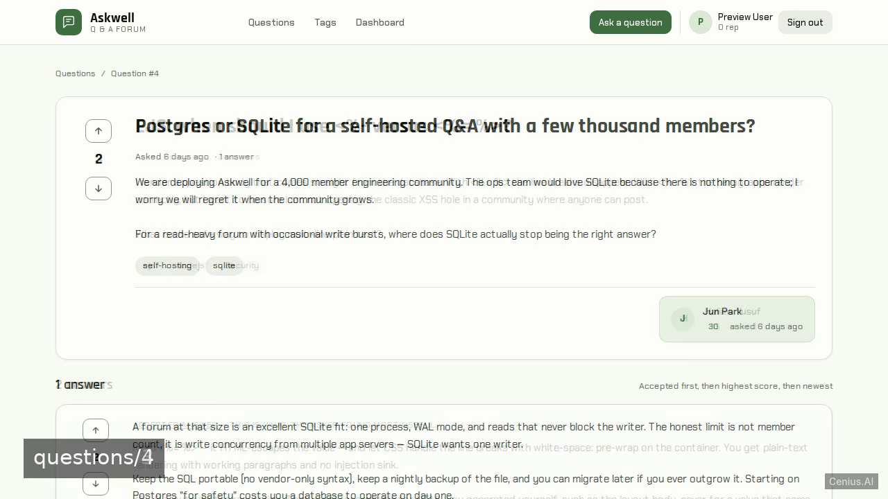
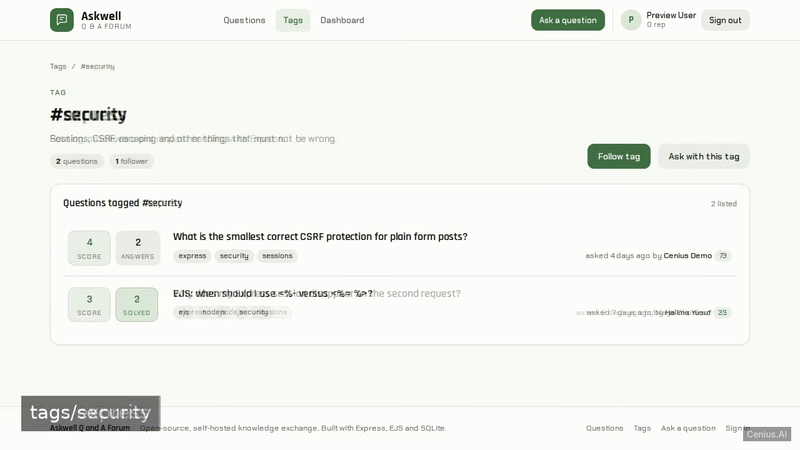
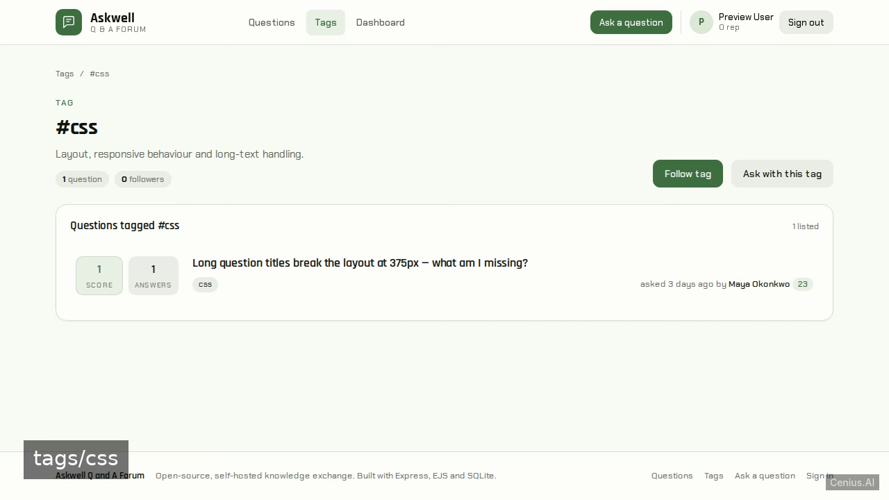
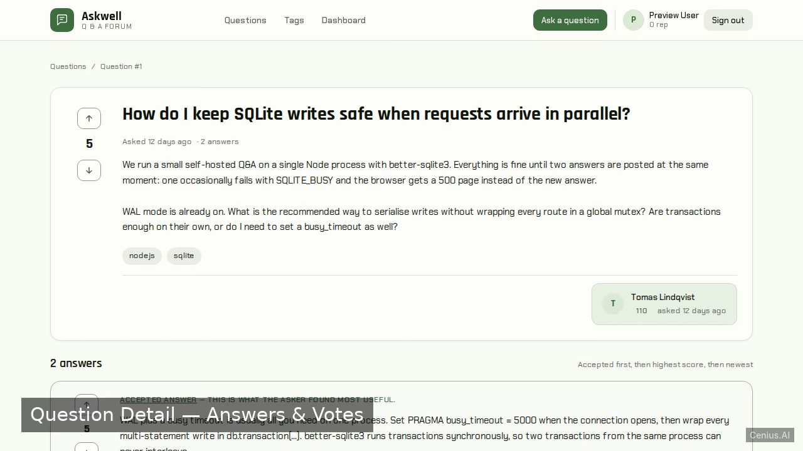

# Askwell Q and A Forum — Node.js knowledge base app reference implementation

**Askwell Q and A Forum** is a production-grade knowledge base app written in Node.js — generated by cenius.ai, Apache-2.0-licensed. Askwell Q and A Forum is a self-hosted, server-rendered Q&A community MVP built with Node.js, Express, EJS, and SQLite. Clone Askwell Q and A Forum, run the installer, done — you have a working product in minutes. Want to change something? [Open Askwell Q and A Forum on cenius.ai](https://cenius.ai/marketplace/p/askwell-q-and-a-forum?ref=gh&utm_campaign=askwell-q-and-a-forum-nodejs) and say what you need — a revised build ships back, ready to deploy.


[](LICENSE)  [](https://cenius.ai)

[](https://cenius.ai/marketplace/p/askwell-q-and-a-forum?ref=gh&utm_campaign=askwell-q-and-a-forum-nodejs)

> **▶ [Open & edit in cenius.ai](https://cenius.ai/marketplace/p/askwell-q-and-a-forum?ref=gh&utm_campaign=askwell-q-and-a-forum-nodejs)** — one click to an editable workspace: describe changes in plain English, get an instant preview, one-click deploy and host. Modifications made on the platform come with full rebrand & relicense rights.

_Local clone? See [Quick start](#quick-start) below. cenius.ai is the zero-setup path._

## Demo





▶ **[Video walkthrough](https://cenius.ai/marketplace/p/askwell-q-and-a-forum?ref=gh&utm_campaign=askwell-q-and-a-forum-nodejs)** — see the app in action on the cenius.ai project page · [MP4 file](.github/media/demo.mp4)

## Screenshots

  

## Usage guide

### Overview

Askwell Q and A Forum — a self-hosted, server-rendered Q&A community (Apache Answer-style) built with Express, EJS and SQLite.

### Quickstart

After completing the install steps in `INSTALL.md`:

```bash
npm run dev    # start the server
## in another terminal:
curl http://localhost:8000/
```

### Endpoints

Every endpoint below was extracted from the source by the route scanner (Next.js / FastAPI / Flask / Django / Express).

_Full guide: [`USAGE.md`](USAGE.md)_

## Features

- Email/password authentication with demo login
- Questions CRUD and browsing
- Answers CRUD
- Voting on questions and answers
- Accepted answer
- Tags with follower counts
- Reputation points and badges per member
- Duplicate-question linking and closing
- Member dashboard

## Quick start

```bash
./install.sh   # installs dependencies + seeds demo data
```

See [`INSTALL.md`](INSTALL.md) for full setup and usage instructions.

## Architecture

The repository contains 93 files of Node.js source, organised under `data/`, `public/`, `scripts/`, `src/`, `tests/`, `views/`. `./install.sh` gets you from a fresh clone to a running instance with sample data in a single step. Full setup details: [`INSTALL.md`](INSTALL.md).

## FAQ

### What's the quickest way to self-host Askwell Q and A Forum?

`git clone` + `./install.sh` gets you a running instance — the install script provisions dependencies and demo data. Full steps live in [`INSTALL.md`](INSTALL.md); nothing external is needed to try it.

### How can I customize Askwell Q and A Forum without editing code?

Open it on [cenius.ai](https://cenius.ai/marketplace/p/askwell-q-and-a-forum?ref=gh&utm_campaign=askwell-q-and-a-forum-nodejs) and describe the changes you want in plain English — the platform modifies the app and gives you a new, downloadable build.

### Which technology stack does Askwell Q and A Forum use?

Powered by Node.js. This repo is the real thing — full source, seed data, and all — ready to clone and start up. Highlights include voting on questions and answers.

### Does the Askwell Q and A Forum license allow commercial use?

Confirmed free for commercial use — MIT terms let you incorporate, resell, or ship it in any product. [LICENSE](LICENSE).

### Is it possible to white-label Askwell Q and A Forum for a client?

White-labeling is supported: fork the MIT-licensed source and rebrand it yourself, or use [cenius.ai](https://cenius.ai/marketplace/p/askwell-q-and-a-forum?ref=gh&utm_campaign=askwell-q-and-a-forum-nodejs) to make changes in a guided workspace — platform modifications come with full rebrand rights.

## License & rebranding

Released under the [Apache License 2.0](LICENSE) (© 2026 Cenius AI) — free for personal and commercial use. The Cenius name/logo are trademarks (see NOTICE).

**Need a customized version?** [Remix this app on cenius.ai](https://cenius.ai/marketplace/p/askwell-q-and-a-forum?ref=gh&utm_campaign=askwell-q-and-a-forum-nodejs) — modifications made on the platform come with **full rebrand & relicense rights** over your derivative.

## Built with cenius.ai

This entire application — code, design, seeded demo data — was generated on **[cenius.ai](https://cenius.ai)** from a plain-English description.

- 🚀 [Build your own app on cenius.ai](https://cenius.ai)
- 🎛️ [Remix Askwell Q and A Forum on the marketplace](https://cenius.ai/marketplace/p/askwell-q-and-a-forum?ref=gh&utm_campaign=askwell-q-and-a-forum-nodejs) — open it in a workspace, prompt for changes, and ship your own version.

More open-source apps: [the Cenius-ai catalog](https://github.com/Cenius-ai) · [showcase index](https://github.com/Cenius-ai/showcase)
